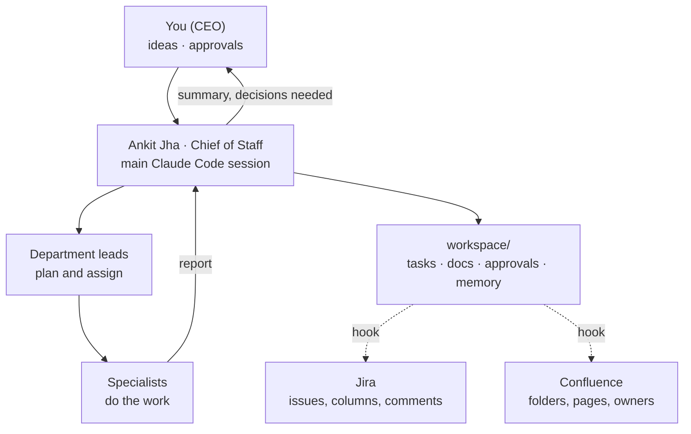

# Agentic Office

### Hire 55 AI employees. Run a startup from your terminal.

**A whole software company of 55 AI employees, run from Claude Code.** You are the CEO. A Chief of Staff agent turns your ideas into tracked work, hands it to the right department, checks the result and reports back. Every ticket can be mirrored to Jira and every document to Confluence, each signed by the agent that wrote it.

[](LICENSE)


-brightgreen)

[](docs/media/agentic-office-promo.mp4)

▶ **[Watch the 73-second tour](https://drive.google.com/file/d/1D73M2WlcavSW7R3fCN5Mn4xsDy1kizcg/view?usp=sharing)**: one idea goes from the CEO prompt to a tested game, with Jira and Confluence kept in sync.

---

## Contents

- [What it is](#what-it-is)
- [See it work](#see-it-work)
- [How it works](#how-it-works)
- [Quick start](#quick-start)
- [Daily use](#daily-use)
- [The team](#the-team)
- [Choose the model for each agent](#choose-the-model-for-each-agent)
- [What it costs](#what-it-costs)
- [Subscription or API key](#subscription-or-api-key)
- [Jira and Confluence](#jira-and-confluence)
- [Project structure](#project-structure)
- [Next steps for you](#next-steps-for-you)
- [Roadmap](#roadmap)
- [Known limitations](#known-limitations)
- [Contributing](#contributing)
- [Support the project](#support-the-project)
- [License and disclaimer](#license-and-disclaimer)

---

## What it is

Agentic Office is a ready-made Claude Code project that behaves like a tech startup:

- **55 agents in 9 departments:** Product, Design, Engineering & QA, Marketing, Sales, Customer Success, Security/Legal/Compliance, People, and Finance & Ops. Each has a name, a startup career history, a personality, responsibilities, a workflow, decision rights, guardrails and a report format.
- **A Chief of Staff (Ankit Jha)** in the main session, who routes your requests, briefs agents, reviews their work and keeps the records.
- **A Company OS** (`CLAUDE.md`): rules, approval gates, routing, memory and operating cadence.
- **Tracked work:** every task is a file with an owner, priority, acceptance criteria and a log of who did what.
- **Approval gates:** agents never deploy, publish, spend money, contact real people or touch personal data without your explicit "approved".
- **Optional Jira and Confluence sync:** tickets, status moves and discussions appear in Jira. Documents appear in a Confluence space, organized in folders, each with an owner panel naming the agent that wrote it.
- **No dependencies:** plain Markdown, plus a few Python standard-library scripts.

It is a starting point for people who want to explore multi-agent workflows with real structure rather than a single chat.

## See it work

We asked the office to build a small game. This is what happened, unedited, in about three minutes:

1. **Ankit (COO)** created task `ENG-1` with acceptance criteria and routed it to the CTO.
2. **Rahul (CTO)** chose the approach and assigned the build and the testing.
3. **Sneha (Frontend Engineer)** built a 63-line tic-tac-toe game with built-in self-checks.
4. **Divya (QA)** tested it against every criterion and filed bug `ENG-2` (keyboard focus lost after each move).
5. **Sneha** fixed the bug. **Ankit** verified the fix and reported back.

A second request produced the full product documentation: scope, functional spec, technical design, 29 test cases and release notes, each written by its owner. Everything is in [`examples/tic-tac-toe/`](examples/tic-tac-toe/).

## How it works



- **Agents are Claude Code [subagents](https://code.claude.com/docs/en/sub-agents)**, one file each in `.claude/agents/`.
- **Subagents cannot call each other**, so every handoff goes through Ankit. This keeps one accountable coordinator and a clean record.
- **`workspace/` is the source of truth.** Tasks are Markdown files in `workspace/jira/`, documents are in `workspace/confluence/`, approvals are in `workspace/approvals/`.
- **Hooks** in `.claude/settings.json` run the sync scripts after every file change, so Jira and Confluence stay current without anyone remembering to update them.
- > [!WARNING]
> **Use an API key, not a Claude subscription, for anything beyond light personal experiments.** This project was built and tested on a Claude Pro/Max subscription. Running dozens of agents and headless sessions goes beyond the ordinary individual use that subscriptions are meant for. [Read why and how to switch](#subscription-or-api-key).


## Quick start

**You need:** [Claude Code](https://code.claude.com/docs/en/overview) (v2.1 or newer), Python 3.9+ (for the optional sync and model scripts), and an Anthropic API key or Claude account.

```bash
git clone https://github.com/ankitjha1405/agentic-office.git
cd agentic-office
claude
```

1. **Sign in with an API key** (recommended, see [why](#subscription-or-api-key)): run `/login` and choose the Anthropic Console account, or start Claude Code with `ANTHROPIC_API_KEY` set.
2. **Accept the "trust this folder" prompt.** Until you do, project permissions are ignored.
3. **Check the team:** run `/agents` to see all 55.
4. **Give your first idea:**
   ```
   /idea A habit tracker for remote teams that nudges people on Slack
   ```
5. **Or ask for something concrete:**
   ```
   Build a simple two-player tic-tac-toe game in a single HTML file. Run it through the normal process.
   ```

Without any further setup, the office works entirely from local files. Jira and Confluence are optional.

**On Windows:** use `py` where the docs say `python3`, and see [Windows notes](docs/integrations.md#windows) for the hooks.

## Daily use

| Command | What it does |
|---|---|
| `/idea <idea>` | Product turns the idea into an opportunity card and a first cheap test |
| `/standup` | Daily status across all departments from the task files |
| `/weekly-review` | Wins, priorities, risks and the decisions you need to make |
| `/approvals` | Everything waiting for your "approved" |
| `/pull-comments` | Brings your Jira comments into the tasks and has Ankit act on them |

You can also talk to Ankit in plain language, or ask for a specific person: *"Ask Neha to draft pricing hypotheses for the habit tracker."*

**Approval gates.** When work needs a deploy, a public post, an email to a real person, spending or data access, the agent prepares it, files it in `workspace/approvals/`, and Ankit waits for you. `.claude/settings.json` also asks before `git push` and deploy commands, and blocks agents from reading `.env`.

## The team

| Department | Lead | People | Owns |
|---|---|---|---|
| Leadership | Ankit Jha (COO, main session) | 1 + you | Routing, cadence, approvals |
| Product & Innovation | Arjun Mehta | 9 | Research, opportunities, pricing, PRDs, roadmap |
| Design & UX | Ananya Sen | 4 | UX research, product design, visual design |
| Engineering & Quality | Rahul Venkatesh (CTO) | 10 | Backend, frontend, 4 QA roles, DevOps |
| Marketing & Growth | Riya Kapoor | 7 | Positioning, content, scripts, publishing, growth analytics |
| Sales & Partnerships | Sameer Bhatia | 6 | Prospecting, qualification, outreach, proposals, CRM |
| Customer Success | Swati Chaturvedi | 5 | Support, onboarding, feedback, retention |
| Security, Legal & Compliance | Rajeev Sharma | 5 | Security, contracts, compliance, release risk |
| People, HR & Culture | Kiran Mathew | 5 | Hiring agents, capacity, learning, evaluations |
| Finance & Operations | Anil Thakur | 4 | Costs, operating calendar, documentation |

Full roster with names, roles, managers and models: [`ROSTER.md`](ROSTER.md). How every profile is structured: [`workspace/confluence/templates/agent-profile.md`](workspace/confluence/templates/agent-profile.md).

## Choose the model for each agent

> [!IMPORTANT]
> **Every agent's model is configurable.** Pick a preset or set individual agents in [`config/models.json`](config/models.json), then run one command. The model you choose for the main session matters most for cost: in our runs it was about 75% of the bill.

```bash
python3 tools/set_models.py --preset budget     # switch preset
python3 tools/set_models.py --show              # see who runs on what
python3 tools/set_models.py                     # re-apply after editing config/models.json
```

| Preset | Main session (Ankit) | 3 strategic leads | 44 standard roles | 8 routine roles | Use when |
|---|---|---|---|---|---|
| `balanced` (default) | your default | opus | sonnet | haiku | Good quality at moderate cost |
| `budget` | sonnet | sonnet | haiku | haiku | Experiments, learning, tight budgets |
| `quality` | opus | opus | opus | sonnet | High-stakes work, cost is secondary |
| `single` | your default | inherit | inherit | inherit | One model for everything |

- **Tiers** are defined in the config. *Strategic* means Product Lead, CTO and Chief Risk Officer. *Routine* means support, feedback sorting, CRM, lead qualification, publishing, capacity, ops coordination and documentation. Everyone else is *standard*.
- **Per-agent overrides** beat the preset: `"overrides": {"backend-engineer-1": "claude-opus-5-5"}`.
- **Accepted values:** `opus`, `sonnet`, `haiku`, `fable`, `inherit`, or a full model ID such as `claude-sonnet-5-5`.
- **The script updates** each agent's `model:` line, the Model column in `ROSTER.md`, and the main-session model in `.claude/settings.json`. You can also edit an agent's `model:` line by hand.
- **To force one model on every agent temporarily** without editing files, set `CLAUDE_CODE_SUBAGENT_MODEL=haiku` and `CLAUDE_CODE_SUBAGENT_MODEL_FORCE=1` ([docs](https://code.claude.com/docs/en/sub-agents)).

## What it costs

> [!NOTE]
> The figures below come from two real runs of this office, as reported by Claude Code at API prices. Monthly figures are estimates for **10 small tasks a day, 30 days a month**. Your costs will differ with task size, session length and models. Check current prices on [Anthropic's pricing page](https://www.anthropic.com/pricing).

**Measured runs** (`balanced` preset, main session on Opus):

| Run | Agents involved | Tokens processed | Of which output | Cost at API prices |
|---|---|---|---|---|
| "Build a tic-tac-toe game" (small task) | COO, CTO, engineer, QA | **~1.34 M** | ~19 K | **$1.08** |
| "Write the full product documentation" (medium task) | COO + 6 agents | **~2.25 M** | ~45 K | **$2.00** |

About 90% of the tokens are *cache reads*: the same instructions and context re-read on every turn, billed at roughly a tenth of normal input price. That is why 1.3 million tokens cost about a dollar.

**10 small tasks a day:**

| | Per day | Per month (30 days) |
|---|---|---|
| Tokens processed | ~13.4 M (~200 K output) | ~400 M |
| API cost, `balanced` preset, main session on Opus (measured rate) | ~$11 | **~$325** |
| API cost, main session on Sonnet (estimate) | ~$7.50 | **~$230** |
| API cost, `budget` preset (estimate) | ~$5.50 | **~$165** |
| Claude Pro subscription | — | $20, but likely to hit usage limits within a few tasks a day |
| Claude Max subscription | — | $100 or $200. Usage limits are not published in tokens; check with `/usage` |

A subscription looks cheaper, but it is not meant for this kind of load. See the next section.

**How to cut cost:** use the `budget` preset or move only the main session to Sonnet. Bring in 2–4 agents per task, not whole departments. Start a fresh session per topic, because long sessions re-read more context. Set a monthly spend limit in the [Claude Console](https://platform.claude.com/). More detail is in [docs/cost-and-models.md](docs/cost-and-models.md).

## Subscription or API key

> [!CAUTION]
> **This project currently runs on whatever you sign in with, and it was developed on a Claude subscription. For regular or automated use, switch to an API key.**

Anthropic's [Claude Code legal and compliance page](https://code.claude.com/docs/en/legal-and-compliance) says:

- Subscription sign-in (OAuth) *"is designed to support ordinary use of Claude Code and other native Anthropic applications."*
- *"Advertised usage limits for Pro and Max plans assume ordinary, individual usage of Claude Code and the Agent SDK."*
- *"Developers building products or services that interact with Claude's capabilities, including those using the Agent SDK, should use API key authentication through Claude Console."*

A 55-agent office with many subagents per task, headless `claude -p` runs and scripted automation is not ordinary individual usage. And if you build anything from this for other people, they must use their own API keys or accounts; you may not route their requests through your subscription.

**How to switch:**

1. Create an API key in the [Claude Console](https://platform.claude.com/) and set a monthly spend limit.
2. In Claude Code, run `/login` and choose the Anthropic Console account, or start it with the key:
   ```bash
   export ANTHROPIC_API_KEY=sk-ant-...
   claude
   ```
3. Pick a model preset that fits your budget (see [above](#choose-the-model-for-each-agent)).

If in doubt about your use case, ask [Anthropic sales](https://www.anthropic.com/contact-sales).

## Jira and Confluence

Both are optional and off until you add credentials to `.env`. Full setup is in **[docs/integrations.md](docs/integrations.md)**.

| In the office | In Jira | In Confluence |
|---|---|---|
| New task file | New issue with owner, goal, acceptance criteria, department and priority labels | — |
| Status change | Issue moves column (Backlog → Selected → In Progress → Blocked → In Review → Done) and gets a comment | — |
| Log entry (report, question, decision) | Issue comment | — |
| Your comment in Jira | Pulled into the task by `/pull-comments` | — |
| New or edited document | — | Page in the matching folder, with an owner panel, owner and department labels, working links to other pages and to Jira issues |

```bash
cp .env.example .env                          # fill in site, email, API token, project and space keys
python3 tools/jira_sync.py check              # verify login and project
python3 tools/jira_sync.py sync               # push tasks
python3 tools/confluence_sync.py sync         # publish docs
```

## Project structure

```
agentic-office/
├── CLAUDE.md                  Company OS: rules, approvals, routing, Ankit's persona
├── ROSTER.md                  Everyone's name, role, manager and model
├── .claude/
│   ├── agents/                55 agent profiles (one Markdown file each)
│   ├── commands/              /idea /standup /weekly-review /approvals /pull-comments
│   └── settings.json          Permissions, approval prompts, sync hooks
├── config/models.json         Which model each agent uses
├── tools/
│   ├── set_models.py          Applies config/models.json
│   ├── jira_sync.py           Tasks → Jira (and comments back)
│   ├── confluence_sync.py     Docs → Confluence
│   └── common.py              Shared helpers
├── workspace/
│   ├── jira/                  Task files (format in README.md)
│   ├── confluence/            Company docs, playbooks, standards, product docs
│   ├── approvals/             Items waiting for the CEO
│   └── memory/                Each agent's log of decisions and lessons
├── products/                  Code the office builds
├── examples/tic-tac-toe/      A complete real run: game, tasks and docs
└── docs/                      Integrations, cost and models, customizing
```

## Next steps for you

1. **Switch to an API key** and set a spend limit ([how](#subscription-or-api-key)).
2. **Choose a model preset** that matches your budget: `python3 tools/set_models.py --preset budget` is a good start.
3. **Make it your company.** Rename products, adjust the Company OS and approval rules in `CLAUDE.md`, and edit personas. See [docs/customizing.md](docs/customizing.md).
4. **Trim the team.** You don't need 55 people for a side project. Delete agent files you won't use and remove them from `ROSTER.md` and `config/models.json`.
5. **Let agents run the tools they need.** By default they can't run commands like `node` or test runners without asking. Add what you trust to `permissions.allow` in `.claude/settings.json` (for example `"Bash(npm test:*)"`), so QA can execute tests instead of only reading code.
6. **Connect Jira and Confluence** if you want a shared view ([docs/integrations.md](docs/integrations.md)).
7. **Start small:** one idea, one task, then `/standup`. Read the task log to see how the agents handed off work.
8. **Share what you learn.** Open an issue or a pull request.

## Roadmap

Ideas where contributions are welcome:

- [ ] Evaluation suite: test cases that check each agent follows its role, permissions and report format
- [ ] Cost dashboard from Claude Code usage data per agent and per task
- [ ] Scheduled rituals (daily stand-up, weekly review) with Claude Code routines or the Agent SDK with API keys
- [ ] Inbound triggers (Slack, email, webhooks) built on the Agent SDK with API key authentication
- [ ] Map agents to Jira assignees, and support Jira team-managed projects
- [ ] Archive Confluence pages when their files are deleted
- [ ] Unit tests for the sync scripts
- [ ] More examples: a landing page, a pricing study, a marketing campaign
- [ ] Persona packs for other kinds of companies (agency, research lab, non-profit)

## Known limitations

- **Coordination is serial.** Subagents can't call each other, so the main session routes every handoff. This makes runs slower, but easier to follow.
- **Sync is one-way** (files → Jira/Confluence), except Jira comments, which come back via `/pull-comments`. Editing an issue or page directly will be overwritten by the next file change.
- **Confluence "Created by" shows your account**, because all agents publish through one API login. The real author is in each page's owner panel and `owner-*` label.
- **Jira board columns** are added through the API that Jira's own board-settings screen uses, which Atlassian could change without notice.
- **Agents only report what they could check.** Without permission to run code, QA verifies by reading code, and says so.
- **Personas are fictional.** Names and backgrounds are invented. The agents are AI and give no professional legal, financial or security advice.

## Contributing

Contributions of every size are welcome: fixes, new agents, playbooks, examples, docs and translations. Read **[CONTRIBUTING.md](CONTRIBUTING.md)** first. It covers the persona rules, how to test changes, and what a good pull request looks like.

## Support the project

⭐ If this is useful or fun, star the repo so others can find it. Share what you built with your office (a post, a reel, a write-up) and open an issue or pull request with ideas, bugs or improvements. The [good first issues](https://github.com/ankitjha1405/agentic-office/labels/good%20first%20issue) are a great place to start.

## License and disclaimer

[MIT](LICENSE) © Ankit Kumar Jha.

This is an independent community project. It is not affiliated with, endorsed by or sponsored by Anthropic or Atlassian. Claude and Claude Code are trademarks of Anthropic; Jira and Confluence are trademarks of Atlassian. You are responsible for complying with the terms of every service you connect and for the costs you incur.
